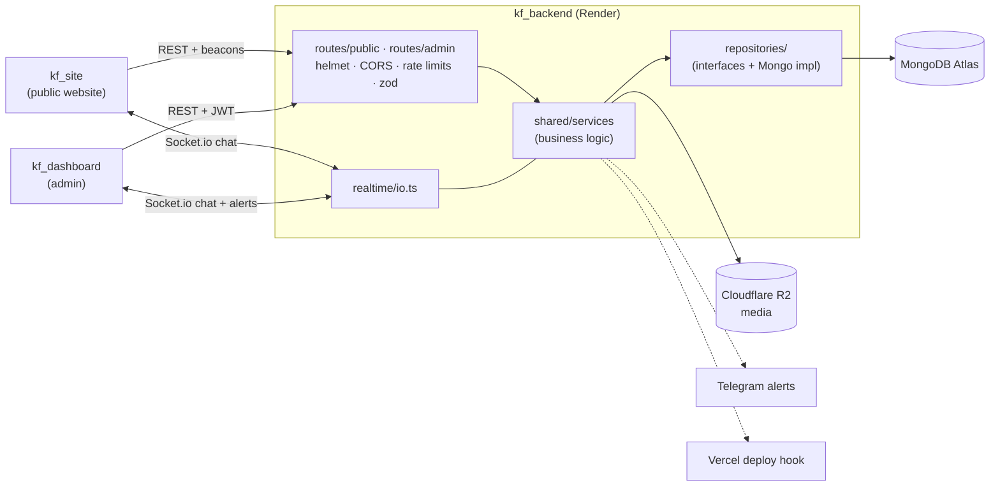

# KF Backend

[](https://github.com/kirollosfayezh/kf_backend/actions/workflows/ci.yml)

> Part of the KF Tech Solutions platform, three repositories:
> **kf_backend** (this API) ·
> [kf_site](https://github.com/kirollosfayezh/kf_site) (public website) ·
> [kf_dashboard](https://github.com/kirollosfayezh/kf_dashboard) (admin dashboard / CMS / CRM).

Express 5 + MongoDB API for the KF Tech Solutions site and dashboard, deployed on
**Render**. Realtime live chat runs over **Socket.io** on the same server. All
database access is confined behind a repository layer, so MongoDB can be swapped
later without touching routes or business logic.

## Architecture



A request flows **route → service → repository**. Routes parse and validate
input and shape the `{ success, data, errors, message }` envelope; services hold
the rules; only `repositories/mongo/*` knows about Mongoose. Errors are thrown as
`AppError` and turned into responses in one place (`shared/middleware/error-handler.ts`).

## Setup (local)

```bash
cp .env.example .env
# Fill MONGODB_URI and JWT_ADMIN_SECRET at minimum
npm install
npm run seed-admin     # creates the first dashboard admin
npm run seed-content   # loads the real site content into the CMS collections
npm run dev
```

Runs on **http://localhost:4000**. Health check: `GET /api/healthz`.

## Scripts

| Command | Description |
|---|---|
| `npm run dev` | Watch mode (`tsx`) |
| `npm run build` | Compile to `dist/` |
| `npm run start` | Run the compiled server (what Render runs) |
| `npm run typecheck` | TypeScript check (includes tests and scripts) |
| `npm run lint` | ESLint (typescript-eslint, recommended rules) |
| `npm run seed-admin` | Create/ensure the first admin user (idempotent) |
| `npm run seed-content` | Load the real site content — services, solutions, projects, blog posts, FAQs, about sections (idempotent, matches on `slug`) |
| `npm run dev:memory` | Run the real server against a throwaway in-memory MongoDB, pre-seeded with the admin and all content — no MongoDB install needed |
| `npm run smoke-test` | Full end-to-end test against a throwaway in-memory MongoDB |
| `npm test` | Unit tests (node:test via `tsx`, no database) — see [Testing](#testing) |
| `npm run backfill-contacts` | File existing leads and chats into CRM contacts (idempotent) — run once after deploying the CRM |
| `npm run update-privacy-policy` | Refresh the stored Privacy Policy from `src/scripts/legal/` where the text is still the seeded wording; dry run by default, `-- --apply` writes |

## Testing

Two layers, both run from source with `tsx`:

- **Unit tests — `npm test`** (node's built-in test runner; runs in CI). Pure
  logic and security-sensitive code: phone rules for every country, contact
  identity matching, UA/UTM parsing, quote totals, booking slots, the article
  publisher, the deploy-hook debounce, JWT verification and login, the
  `requireAdmin` guard, the error handler, CORS allowlisting, CSV/Telegram
  escaping, and the zod schemas of the public form endpoints. Route tests mount
  one real router on an ephemeral port with the repositories replaced in memory
  (`src/testing/fake-repos.ts`), so they exercise the real route, schema and
  service code with no database.
- **End-to-end — `npm run smoke-test`** (local only, not in CI). Needs no
  configuration — it spins up its own in-memory MongoDB, boots the real server
  with Socket.io, and runs ~140 checks over HTTP and websockets: auth, content,
  SEO and translation overrides, leads, settings, the realtime chat round-trip,
  analytics, the whole CRM cycle (visitor → consent → lead/chat → contact →
  quote → booking → alerts → erasure), the newsletter and rate limits. Each
  area is a module in `src/scripts/smoke/`. Run it after any backend change.

Where MongoDB binaries cannot be downloaded, point the smoke test at any running
server instead: `SMOKE_MONGODB_URI=mongodb://127.0.0.1:27017 npm run smoke-test` (each
run uses a fresh database). Against FerretDB add `SMOKE_SKIP_SEED=1` — it cannot
store the seed data's nested arrays — and expect the analytics-summary checks to
fail, as FerretDB lacks `$cond`.

CI (`.github/workflows/ci.yml`) runs `npm ci` (which also runs the production
build via `postinstall`), lint, typecheck, unit tests and build on every push
and pull request, with placeholder env vars and no secrets.

## CRM

- **Visitors.** The site's analytics beacon also sends a `session` event (referrer,
  UTM/click ids, time zone, screen) and the cookie choice. Each browser gets a
  profile; anonymous ones expire 13 months after the last visit.
- **Contacts.** Leads, chat sessions, bookings and accepted quotes are matched
  by E.164 phone or email into one contact (`resolveContact` in
  `shared/services/contacts.service.ts`), which collects every linked browser's
  journey. `DELETE /api/admin/contacts/:id` erases the person and everything
  linked (GDPR).
- **Quotes** are shared by a random token link (`/q/<token>` on the site).
- **Bookings** use the opening hours in CRM settings, in the business time zone.
- **Alerts** go to the dashboard (live) and, when configured, Telegram. The
  token lives in the admin-only `crmSettings` document and is never returned.

### Telegram alerts

1. In Telegram, message **@BotFather** → `/newbot` → copy the token.
2. Open your bot and press **Start**.
3. Get your chat id from **@userinfobot** (or a group's id).
4. Dashboard → **Alerts** → paste both, switch on, **Send test**.
5. Optionally set `DASHBOARD_URL` so each alert links to the contact.

### Reminders on a sleeping host

"Call in 15 minutes" and "follow-up due" alerts come from a timer in the running
server. Render's free tier sleeps after 15 idle minutes, and nothing fires while
it sleeps (the dashboard also triggers the check whenever it is opened). To keep
reminders on time, add a free uptime monitor (e.g. UptimeRobot, cron-job.org)
that requests `/api/healthz` every 10 minutes, or use a paid instance.

## Default admin (after seeding)

- Email: `SUPERADMIN_EMAIL` (default `admin@kftech.solutions`)
- Password: `SUPERADMIN_PASSWORD` (default `ChangeMe123!`)

Change both before production.

## API surface

All routes are under `/api`. Responses use a consistent envelope:
`{ success, data, errors, message }`.

### Public (site)

| Route | Purpose |
|---|---|
| `GET /api/healthz` | Health check |
| `GET /api/content/settings` | Site settings (branding, languages, SEO, pixels) |
| `GET /api/content/:collection` | Published items — `:collection` is one of `projects`, `services`, `solutions`, `testimonials`, `faqs`, `blogPosts`, `aboutSections` |
| `GET /api/content/:collection/:id` | One published item |
| `POST /api/leads` | Create a lead — `source: "contact" \| "campaign"` plus name/email/message and optional phone/company/projectType/budget |
| `POST /api/chat/threads/:visitorId` | Open/annotate a chat thread (`{name, contact}` optional) |
| `GET /api/chat/threads/:visitorId/messages` | Chat history |
| `POST /api/chat/threads/:visitorId/messages` | Send a visitor message (`{text}`) |
| `PATCH /api/chat/threads/:visitorId/typing` | Visitor typing indicator (`{typing}`) |
| `POST /api/chat/session` | Phone step: `{visitorId, phone, country?, name?}` → starts or resumes the latest chat for that number |
| `GET /api/chat/threads/:visitorId` | This browser's thread (or `null`) |
| `POST /api/analytics/events` | Beacon batch: `pageview`, `click`, `conversion`, `session`, `consent` |
| `POST /api/newsletter` | Subscribe `{email, lang?, source?, visitorId?}` — 201 when new, 200 when already subscribed |
| `GET /api/translations/:lang` | Dashboard translation overrides for one language |
| `GET /api/bookings/slots` | Free call slots |
| `POST /api/bookings` | Book a call `{start, phone, name?, topic?, visitorId?, lang?}` |
| `GET /api/quotes/:token` | A client's quote (records the first view) |
| `POST /api/quotes/:token/accept` / `decline` | Answer a quote (`{name}` / `{reason}`) |

### Admin (dashboard — requires `Authorization: Bearer <JWT>`)

| Route | Purpose |
|---|---|
| `POST /api/admin/auth/login` | `{email, password}` → `{token, user}` |
| `GET /api/admin/auth/me` | Validate session / fetch current admin |
| `GET /api/admin/leads?status=` | List leads, optional status filter |
| `PATCH /api/admin/leads/:id/status` | Update lead status (`new`/`contacted`/`won`/`lost`) |
| `GET /api/admin/content/:collection` | List all items (including unpublished) |
| `POST /api/admin/content/:collection` | Create item |
| `PATCH /api/admin/content/:collection/:id` | Update item |
| `DELETE /api/admin/content/:collection/:id` | Delete item |
| `GET/PATCH /api/admin/settings` | Read/update site settings |
| `GET/POST/DELETE /api/admin/media` | List / upload / delete media |
| `GET /api/admin/chat/threads` | All chat threads, newest activity first |
| `GET /api/admin/chat/threads/:visitorId/messages` | Thread history |
| `POST /api/admin/chat/threads/:visitorId/messages` | Reply as the agent (`{text}`) |
| `PATCH /api/admin/chat/threads/:visitorId/typing` | Agent typing indicator (`{typing}`) |
| `GET/POST /api/admin/contacts` | List (`?q=&stage=&source=`) / add a contact |
| `GET/PATCH/DELETE /api/admin/contacts/:id` | Contact detail (timeline, journey, consent, chats, leads) / update / erase |
| `POST /api/admin/contacts/:id/notes` | Add a note to the timeline |
| `GET /api/admin/crm/overview` | Pipeline, new contacts, online now, follow-ups, recent activity |
| `GET /api/admin/crm/visitors[/:visitorId]` | Visitor profiles and journeys |
| `GET /api/admin/crm/consent` | Cookie-consent log and totals |
| `GET/POST/PATCH/DELETE /api/admin/quotes[/:id]`, `POST …/:id/sent` | Quotes |
| `GET /api/admin/bookings`, `PATCH /api/admin/bookings/:id` | Bookings |
| `GET /api/admin/notifications`, `GET …/count`, `POST …/read`, `POST …/check` | Alert feed |
| `GET/PATCH /api/admin/crm-settings`, `POST …/telegram/test` | Booking hours, quote details, Telegram |
| `GET/PUT/DELETE /api/admin/translations`, `POST …/import` | Site translation overrides |
| `GET /api/admin/newsletter?q=&format=csv`, `DELETE …/:id` | Newsletter subscribers (list, search, CSV export, remove) |

## Realtime chat (Socket.io)

Socket.io is a **push channel only** — every write goes through the REST routes
above (so a brief disconnect can never lose a message), and the route then emits
the saved result. Clients connect to the server's base URL.

**Handshake auth**

- Dashboard: `auth: { token }` — the admin JWT. Verified on connect; an invalid
  token is disconnected immediately. Joins the `admins` room.
- Site visitor: `auth: { visitorId }` — the random id the browser generated and
  stored in `localStorage`. Joins only that visitor's own thread room.

**Events emitted by the server**

| Event | To | Payload |
|---|---|---|
| `chat:message` | the thread's room | the saved message |
| `chat:thread-updated` | `admins` | `{ thread, message }` |
| `chat:typing` | `admins` | `{ visitorId, typing }` — the **visitor** is typing |
| `chat:agent-typing` | the thread's room | `{ visitorId, typing }` — the **agent** is typing |

**Events accepted from admin clients:** `chat:watch` / `chat:unwatch` with a
`visitorId`, to start/stop receiving `chat:message` for one thread.

A visitor is identified only by their generated `visitorId` — there is no visitor
login, so treat thread contents as low-sensitivity (the same trust model as the
original widget this replaces).

## Abuse protection

The unauthenticated endpoints are rate limited per IP (see
`src/shared/middleware/rate-limit.ts`):

| Endpoint | Limit |
|---|---|
| `POST /api/leads` | 5 per 10 minutes |
| `POST /api/newsletter` | 5 per 10 minutes |
| `/api/chat/*` writes | 30 per minute |
| `POST /api/admin/auth/login` | 10 failed attempts per 15 minutes |

Counters are in memory, so they are **per instance**. That is fine on a single
Render instance; if the service is scaled out, move the store to Redis rather
than raising the limits. `app.set("trust proxy", 1)` is set so the limiters see
the real client IP behind Render's proxy rather than the proxy's own.

Media uploads are restricted to an allowlist (`jpeg`, `png`, `webp`, `gif`,
`avif`, `mp4`, `pdf`) with a 10 MB cap. **SVG is deliberately excluded** because
it can carry script and uploads are served from a public URL.

## Database-swap design

Nothing outside `src/repositories/mongo/*` imports a Mongoose model. Routes and
services depend only on the `Repository<T>` / `SingletonRepository<T>` interfaces
in `src/repositories/types.ts` (plus the small bespoke `ChatRepository` shape,
which chat needs because a thread-plus-messages doesn't fit the generic CRUD
interface). `src/repositories/index.ts` is the one factory file wiring interfaces
to MongoDB implementations — to move to another database, write new classes
implementing the same interfaces and change only that file.

## Media storage

Uploads go to any **S3-compatible bucket** (Cloudflare R2 by default) when the
`CLOUDFLARE_R2_*` vars are set. Without them, uploads fall back to local disk,
which is fine locally but **ephemeral on Render** — configure a bucket before
relying on media in production.

## Structure

```
src/
  index.ts                 # boots Mongo, HTTP server, Socket.io
  app.ts                   # Express app, mounts routers under /api
  config/                  # env
  db/connect.ts            # Mongoose connection
  models/                  # Mongoose schemas
  repositories/            # Repository interfaces + Mongo implementations + factory
  realtime/io.ts           # Socket.io server, rooms, emit helpers
  shared/
    services/               # business logic (auth, leads, content, CRM, quotes, bookings, chat, …)
    types/                  # domain types, one module per area (leads, content, crm, sales, …)
    middleware/             # requireAdmin (JWT), rate limits, error handling
    http/                   # response envelope, async handler, zod body parsing
    errors/                 # AppError
    *.ts                    # pure helpers: phone, slots, quote math, tracking, contact merge
  routes/
    public/                 # site-facing endpoints (+ zod schemas for the form writes)
    admin/                  # dashboard-facing endpoints
  scripts/                  # seed/maintenance scripts; smoke-test.ts + smoke/ sections
  testing/                  # unit-test helpers (in-memory repos, router harness)
```

Unit tests sit next to the code they test as `*.test.ts`.

## Design decisions

- **Repository seam.** Services call `repos.*` interfaces, never Mongoose, so the
  database can change in one file — and unit tests can swap repositories in
  memory instead of needing MongoDB. The cost is some hand-written mapping code.
- **Validation split.** zod checks the *shape* of public request bodies at the
  route; business rules and their user-facing messages stay in the services,
  which scripts call too. Schemas were introduced to accept exactly what the
  hand-written checks accepted, with tests over the site's real payloads.
- **Push-only realtime.** Every chat write goes through REST and is then
  broadcast over Socket.io, so a dropped socket never loses a message.
- **Fail soft on side effects.** CRM filing, alerts (Telegram) and site-rebuild
  hooks are wrapped so they can never fail the lead, booking or edit that
  triggered them.
- **Production build without devDependencies.** Render installs with
  `NODE_ENV=production`, so the compiler and types are runtime dependencies and
  `postinstall` builds; test and smoke-test code is excluded from `dist/`.
- **In-memory rate limits.** Simple and sufficient on one instance; documented
  as the thing to move to Redis before scaling out.

## Deploy to Render

This repo contains `render.yaml` (Blueprint). Either use it, or create a web
service manually:

| Setting | Value |
|---|---|
| Root directory | *(leave blank — this repo's root is the service)* |
| Build command | `npm ci` |
| Start command | `npm run start` |
| Health check path | `/api/healthz` |

Render sets `PORT` itself — **do not set `PORT` as an env var**, or the health
check will probe the wrong port. Set every non-optional env var from
`.env.example` in the Render dashboard, then run `npm run seed-admin` and
`npm run seed-content` once from the Render Shell.

### Why the build works under `NODE_ENV=production`

Render sets `NODE_ENV=production`, which makes npm skip `devDependencies`. So
everything compilation needs — `typescript` and the `@types/*` packages — is a
regular dependency, and `postinstall` runs the build. That means `npm ci` alone
produces `dist/`, whatever Build Command the service ends up with. The two
dev-only scripts (`smoke-test`, `dev-memory`) import devDependencies, so
`tsconfig.build.json` excludes them from the compiled output; they are always
run from source with `tsx` instead. `npm run typecheck` still covers everything.

**MongoDB Atlas:** allow Render's egress IPs under Network Access, and use the
Atlas connection string as `MONGODB_URI`.

**CORS:** set `CORS_ORIGINS` to the deployed site + dashboard URLs
(comma-separated, no trailing slash). It also governs which origins may open a
Socket.io connection. When it is empty, production (`NODE_ENV=production` or
Render's `RENDER=true`) falls back to the live site and dashboard origins and
refuses everything else; only development reflects any origin, so any Vite port
works. See `src/config/cors.ts`.

**Secrets:** production refuses to start without its own `JWT_ADMIN_SECRET`
(the development fallback is public in this repo), and `npm run seed-admin`
refuses to create a production admin unless `SUPERADMIN_PASSWORD` is set.

### Site rebuilds after edits

The site prerenders its pages, sitemap and feeds at build time, so a blog post
or SEO override saved in the dashboard only reaches crawlers at the next
deploy. Set `VERCEL_DEPLOY_HOOK_URL` (Vercel → Project → Settings → Git →
Deploy Hooks) and the API requests a rebuild after any content, settings or SEO
write — debounced to one request per minute of activity, never more than one in
flight, and never failing the write itself. Without the variable nothing is
requested.

| Variable | Purpose |
|---|---|
| `VERCEL_DEPLOY_HOOK_URL` | Optional. Deploy Hook URL that rebuilds the site after CMS/SEO/settings edits |

## License

[MIT](LICENSE) © 2026 Kirollos Fayez
